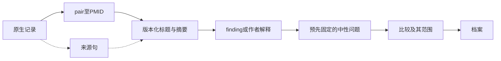

# 从资源覆盖到可核对的跨文章比较

**英文暂定标题：** Checkable cross-article comparisons from two literature resources: a proposal for gene–cancer evidence dossiers

面向生物医学研究者和文献分析人员。输入是一个 gene–cancer pair 和一份冻结的标题与摘要。输出是一份可追溯的证据比较档案，说明不同文章分别报告了什么、能在哪个层面对照、以及为什么还不能对照。当前优先处理表达或分布，以及表达与预后的关联。其他问题类型保留为范围外或待细分，不自动当成无用证据。这不是治疗建议系统。用户场景来自研究设想和导师方向，还没有做过需求研究。

## 文献里已经有什么，还缺哪一步

同一 pair 的文章经常测量不同对象、结局和条件。研究者需要的不是再得到一个三元组，而是知道哪些发现可以放在一起看。已有工作已经覆盖了这条路上的若干段，不能概括成“知识库都是简单三元组”或“此前没有人考虑条件”。

CORE 是癌症基因表达知识库，不是全部癌症知识 [C-LIT-CORE]。它用有限人工标注，把句子组织成基因、疾病和基因表达–癌症状态的记录。SemMedDB 是 PubMed 规模的语义谓词库，谓词连接概念，不等同于带参照和条件的结果记录 [C-LIT-SEMMED]。Evidence Inference 在单篇临床试验全文里判断两种治疗相对某一结局的方向，并标出支持句 [C-LIT-EI]。CARE 把临床发现标成实体与属性的 n 元关系，材料是临床试验和病例报告摘要，任务仍是单篇提取 [C-LIT-CARE]。SciClaim 为科学主张抽取带修饰属性的细粒度图，语料含 PubMed，但不是给定 gene–cancer 问题下的跨文章比较 [C-LIT-SCICLAIM]。EvidenceNet 从肝癌、结直肠癌和系统性红斑狼疮全文做成带来源段落、研究情境、定量属性和记录间关系的证据记录；它已经覆盖实验发现和记录关系，不能只因为它用全文就说它没做本项目要做的事，它的自报技术指标也不是本项目的效果 [C-LIT-EVNET]。TrialMind 把系统综述里的检索、筛选和提取串起来，并在小规模用户研究里报告了时间变化 [C-LIT-TRIAL]。OpenScholar 用检索增强模型综合多篇文献并给出引用，评价的是回答正确性和引用，不是 gene–cancer 条件下的比较边界 [C-LIT-OS]。Lawlor、Tilling 与 Davey Smith 把三角互证定义为用偏倚来源不同的研究设计互相约束因果判断；期刊年为 2016 [C-LIT-TRI]。Liu 与 Gaunt 的 Annotated Semantic Queries 题名指向带标注语义查询的证据三角，本轮没有读到方法，不能判断它做到哪一步 [C-LIT-ASQ]。ERASER 定义了理由与预测一致性的评测；本项目没有计算那些概率指标，只在解释扰动思路时引用它 [C-LIT-ERASER]。

由此分开四件事。有来源的关系记录，不等于有参照对象和条件的结果记录。单篇提取或主张核查，不等于在给定问题下比较多篇文章。两个库的材料覆盖不同，不等于从不同偏倚来源做因果三角互证。自动生成引用，不等于人工核对后的判断，也不等于用户任务已经改善。

保守的研究缺口是：两个现有文献资源的覆盖差异，在明确的文本范围内，能转化成怎样的可核对跨文章比较，以及这些比较在哪些条件上仍然不能成立。创新不在于“别人没有把 CORE 和 SemMedDB 这两个名字写在一起”。

## 研究问题与核心定义

一段任务：给定 gene–cancer pair 和冻结摘要，先把每篇文章里与任务相关的陈述整理成可定位的记录，再按预先写好的中性问题比较文章，并标明比较停在描述、方向还是数值，以及缺了什么条件。代码负责标识连接、字段结构和引用能否在给定文本中定位。原文是否支持该字段，由随后的有限人工核对判断。

三个问题保持原有范围。RQ1：摘要中的任务相关发现及其限定信息能否被忠实组织？RQ2：不同文章的结果能在哪些层面比较，哪些差异或缺项限制比较，模型组织的比较是否经得起核对？RQ3：两个资源分别以及合在一起提供哪些比较材料，其中哪些比较在人工核对后仍然成立？

| 问题 | 评价单位 | 现在能算的 | 依赖人工、目前 not_evaluated | 不能推出 |
| --- | --- | --- | --- | --- |
| RQ1 | 一条输出及其字段 | 引用能否在送入模型的文本中定位 | 原文支持；实体、形式、问题类型、参照、结局、方向是否错误 | 全部输出的召回；字符串不同即拆分错误 |
| RQ2 | 案例，其内组成部分另计 | 程序是否分出描述、方向、数值和失败 | 人工参考与模型状态的交叉 | 把状态压成等距总分；用最高组成部分代表整个案例 |
| RQ3 | 固定案例集合 | 该 pair 的 pair–PMID 是否足以形成文章对 | 核对后仍成立的比较，以及相对单库的增量 | 组合变多等于方法有效，或等于用户获益 |

术语按现有 schema 使用，不在本轮改名。原生 KG 记录是库里的一条谓词或 GCS，不是一篇独立研究。pair 是 gene–disease 标识对。pair–PMID 是这个 pair 与一篇文章的连接。文章不是独立研究：同一队列可以对应多篇 PMID。来源句是库中保存的句子，只有与摘要确认匹配时才连成同一句。版本化标题和摘要是实际送入模型的文本及其版本号。实证 finding 与作者解释目前都可能叫 finding，用 discourse_role 区分；只有本文结果进入未来的实证比较，作者解释保留为档案中的 statement。问题类型先分表达或分布、预后关联，以及其他。实体身份回答是不是任务对象；测量或干预形式回答 RNA、蛋白、配体、受体或构建体。RNA 与蛋白、受体与配体、构建体与被测对象不因名称相近合并。参照对象、结局和条件分开记录。报告方向是单篇怎么写；对照方向要求参照和结局已经对齐。直接比较数值还要求尺度可对照。证据定位是程序在给定文本中找到引用；原文支持是待人工判断的语义关系。不显著不等于无效应，数值相近不等于可以合并效应。观察到 HBV 状态、组织区室或测量方法不同，只说明这些条件需要考虑，不断言它们导致了结果差异。

“原文支持输出”只回答文本忠实性。“方法可信度”涉及研究设计的偏倚。“结论为真”还需要更广的科学证据。三者都不叫同一个 confidence。

实线只表示已经实现、并可在现有产物中复核的连接。来源句与摘要之间是虚线：没有确认匹配就不视为同一句。一个摘要 finding 不要求已经有对应的 KG 边。原生字段保持各自的谓词，不制造统一 predicate。字段证据的标准化还没有完成：历史比较的 field_link 仍是 field_link_unknown，定位成功没有被写成语义支持。

## 两个资源实际覆盖了什么

CORE 的本地依据是 `data.ttl` 与 `schema.owl`，不是论文中的全部筛选阶段。显式 pair 153,016 个，pair–PMID 321,201 条，唯一 PMID 161,449 个 [C-DATA-CORE]。四个句子标签如上，不改写成 SemMedDB 谓词。hasType 在 GCS 上的存储计数为 BIOMARKER 105,089、ONCOGENE 35,520、TSG 12,407；构建分数没有写入 RDF，UNRELIABLE 在这份存储结果里没有出现，也不表示论文质量 [C-DATA-HASTYPE]。论文发表日期是 2023-09-27；本地文件的下载日期和本项目处理日期与此不同，不写成“最新版”。

SemMedDB 主分析使用本地文件名 `semmedVER43_2024_R` 的六张表。官方下载页写明：MEDLINE Baseline 2022 加更新文件至 2024-05-08，SemRep 1.8，未开启回指，并称为最后一次更新；页面同时写明这些工具自 2024-12-31 起不再维护 [C-DATA-SEMMED]。本地行数与该页一致：引文 37,233,341，句子 263,160,520，谓词 130,480,195，辅助表 130,480,181，实体 1,982,424,585，通用概念 259。本地没有独立校验和，因此不声称字节级等同。PYEAR 是完成日期，不是发表年。谓词表有三列尚未确认，实体表的 sentence 连接仍未解析。范围 E 是语义类型恰好为 gngm 与 neop 的谓词子集，619,022 行，不是完整癌症集合。

选择这两个资源，是因为一个提供癌症基因表达状态，一个提供大规模谓词；标识可以通过 Entrez 与概念标识连接；覆盖差异已经能算出来；而且两份数据已经在本地。这不说明评估过其他库，也不说明它们是最佳组合。

| 对象 | 数量 | 单位 | 回答的问题 |
| --- | --- | --- | --- |
| CORE 显式 pair / pair–PMID / PMID | 153,016 / 321,201 / 161,449 | 标识对、连接、文章 | CORE 材料有多大 |
| 共享 pair / SemMedDB pair–PMID / PMID | 30,910 / 137,221 / 113,380 | 规则接受后的聚合 | 主匹配有多大 |
| 五类 identical 至 disjoint | 5,303 / 2,626 / 1,590 / 3,883 / 17,508 | 两侧 PMID 都非空的 pair | 覆盖如何不同 |
| SemMedDB 侧 PMID 为空的 CORE pair | 122,106 | pair，类别 semmed_pmids_empty | 不进入两侧都非空的主匹配 |
| pair–PMID 交集 / PMID 交集 / PMID 并集 | 17,260 / 31,412 / 243,417 | 不同的交集 | 不能互相替代 |
| 范围 E 的 accepted pair，其中属于 CORE | 161,490，其中 27,028 | pair | E 大于主匹配，也不是全部癌症 |

参数漏斗的单位是 core-anchored 参数行：8,741,634 到接受 513,477，再到 173,048 行精确落在 CORE pair。另有 340,429 行被排除，是因为 gene–disease 不构成 CORE 显式 pair。30,910 与 137,221 是这些行聚合后的 pair 和 pair–PMID，不是又一次排除 [C-DATA-FUNNEL]。主结果里另有 3,882 个共享 pair 不属于精确的 gngm–neop 范围。

共同文章集合有 161,405 个 PMID。原共享 pair 经文章筛选后双侧非空 20,325。年份表补齐后，同一共享 pair 集合中双侧非空是 27,193，不再使用旧的 18,307 [C-DATA-YEAR]。在这 27,193 个 pair 内，年份筛选前后的交集/并集文章数是 16,227/217,346 到 15,250/201,305。共同文章筛选是另一个集合：20,325 个 pair 上，17,260/177,285 到 17,260/100,393。两个 Jaccard 变化来自不同子集和不同过滤，不是因果效应。旧年份表只覆盖 CORE 的 PMID，因此 81,968 个 PMID、96,649 条 pair–PMID 曾被标成缺年份；这是表的覆盖，不是生物学发现。

accepted 表示规则接受。路径 A 不把逐条实体一致当作接受条件；NCBI 与名称核对只在样本上做过；停用标识没有自动替换。30,910 不是已人工验证的正确对齐数。早期更小的规则计数，包括 id_rule_v1 的 276，不进入当前分母 [C-DATA-ACCEPT]。

## 实际方法，以及还没有运行的部分

当前可以准确写成：基于规则的来源与标识连接，加上生成式模型的结构化提取和比较，加上确定性的追溯和来源计算，以及尚未开始的有限人工核对。模型服务记录为 gpt-6.1-sol、standard 档；返回的模型名是接口别名，不能据此证明供应方身份或固定权重快照。encoder、MedCPT 和开放模型没有进入已运行路径。E4 的代码存在，实验没有执行。

主 pilot 计划按五类覆盖各取一小一大，共 10 个 pair。identical 在 4–8 与 9–20 两档没有候选，因为该类的并集达到 4 已经意味着两侧都至少有两篇。实际纳入 8 个 pair。{{UNIQUE_PMID_SENTENCE}}这些文本是 PubMed 标题和摘要，不是全文 [C-PILOT-SAMPLE]。

{{FINDING_ROLE_SENTENCE}}

5,812 是旧 finding 的跨 PMID 组合。其中 5,030 条走入信息不足分支，主因是 4,600 条 other 或 unknown，以及 430 条旧字段为空。这是规则分支，不是人工确认摘要没有信息。CRP 与 GATA3 对合计影响大，合计比例不代替每个 pair 的比例 [C-PILOT-5812]。

E1 的条件元组依赖自由文本，相同生物学情境的不同写法会分成不同元组，因此元组数不是独立情境数。50 次等文章量重采样只在同一样本上改抽样，不是 50 个独立实验；它只保留为敏感性探索 [C-PILOT-E1]。E2 中，D 是不看 KG 标签的直接摘要比较，F 是逐篇提取，K 是在提取输入中附加原始 KG 字段。K 只有四个 small pair 的提取，比较和综合请求为 0，不能与 D、F 对齐成同一种最终产物 [C-PILOT-E2]。E3 的 16 对里，来源句结果栏 13 行非空、3 行未能判断，结论栏 8 行非空；摘要两栏均为 16。文本版本对应不足，不能写成摘要提高了准确率 [C-PILOT-E3]。E4 与开放模型未执行。早期 E6 没有按每篇一次做完；e6_diagnostic_v1 是另一次有限诊断，不是把原实验补完。

24 条历史比较仍按旧单位保留：24 条可描述，8 条可对照方向，0 条可直接比数值，均未人工验证。CDC45 的 12 条来自 6 个文章对和 2 类问题，材料四类为 9/0/3/0。CA IX 的 12 条来自 12 个文章对和 1 类问题，四类为 0/7/2/3 [C-PILOT-24]。{{CASE_UNIT_SENTENCE}}

来源四类只使用该 pair 自己的 PMID 集：两篇都在 CORE 且都在 SemMedDB，为两库各自都能形成文章对；只满足一侧，为仅该库能形成；两侧都不满足但两篇都在并集内，为必须联合才能形成。这是材料事实，不是单库模型能力，也不是两份独立证据。中性问题不由库来源决定。

E6 诊断对 14 篇各做了 r0 与 r1，没有第三轮。finding 数变化 4/14；可对齐 31，未对齐 5。问题类型字符串不同 4/31，角色 1/31。自由文本方向 26/31、结局 22/31 不同，是措辞差异，不是 26 次语义翻转。四个比较案例在三次完整摘要上方向标签一致；每种扰动只有一次。保留或删除引用句各有一个案例出现新的方向标签。这不是端到端可靠性 [C-PILOT-E6]。readiness 实际完成 4 次提取和 2 次比较，74 条证据记录都能在当轮文本中定位。比较使用的是当轮提取。这是 schema 和定位通过，语义支持 not_evaluated [C-PILOT-READY]。

E5 从更早的候选收到 3 个冻结问题，并在规范内深读 27 篇。复核状态是模型给出的 refined 或 still_open，不是证实的文献空白。其中一个仍开放的例子是：已读摘要没有按 HBV、对照肝组织和蛋白测量分层解释 CDC45 在肝癌与非肿瘤肝中的表达方向；这只说明该样本未回答，不说明文献没有答案。它不进入主要贡献 [C-PILOT-E5]。

结构化字段让比较对象可写下来，但不证明它优于直接读摘要。若要保留这个优越性主张，需要同一文献、同一问题、同一模型、独立参考的对照。本 proposal 不做这个对照，因此不把优越性写成贡献。单一模型是实施选择。两库联合目前只支持材料互补的描述；没有单库独立重跑或等信息量对照，不声称联合提高准确率。有限人工核对评估选定输出是否合理，不单独证明节省时间、临床受益或科研决策改善。

## 正式评价打算怎么做

正式设计采用 v2，不把 v1 的“先抽完 shared”和“事后凑一半可比、一半不可比”拼回来。起始规模是 4 个新 pair、每 pair 4–6 篇、最多 24 个唯一 PMID、最多 24 个文章对–问题案例。这是可行性起点，不是功效分析。每个非空来源层先取一篇再轮转；每库至少两篇；共享篇可计入两库，唯一 PMID 只计一次。开发 pair 整对排除，其他 pair 只去掉正文已经暴露的 PMID。仅出现过 PMID 的记录不等于读过正文。中性问题和案例在看模型输出之前固定。技术失败、无 finding 和合法的不能判断都留在分母里。本轮不执行 formal_draw。

一名有背景的评阅者先独立阅读 phase A 的原文，锁定后再看 phase B 的模型输出。第二人只在可以找到时复核预定的小子集。一个人不能计算一致性。评阅者还没有指定，A/B 表单的字段粒度也还没有经试用修订。计划可以写出，不能写成已经标注或已经校准。研究者档案场景和首次不做计时阅读，已经接受，不再列为待批准事项。

分析以有限样本内的描述为主。只对预先列出目标结果的摘要讨论遗漏，不给全部输出计算召回。重复文章、共享队列或公开数据集若摘要写明就记录依赖；看不出来时不声称样本独立。不做总体比例推断，也不做无意义的显著性检验。

## 已有观察如何改变设计

| 观察 | 对设计的影响 | 尚不能推出 |
| --- | --- | --- |
| 五类覆盖不同；另有 122,106 个 CORE pair 的 SemMedDB 侧为空 [C-DATA-FIVE] | 正式样本按来源层轮转，而不是先抽完共享文章 | 覆盖差异等于科学上的支持或反驳 |
| 5,030 条旧规则分支主要来自 other 和空字段 [C-PILOT-5812] | 中性问题预先固定为表达和预后；空字段不再升级成研究缺口 | 摘要本身没有信息 |
| 历史比较 24 可描述、8 可对照方向、0 可直接比数值 [C-PILOT-24] | 比较范围分成报告模式和对齐后的方向，不把不同模式叫成相反 | 这些标签经人工核对后仍成立 |
| 74 条引用可定位，语义支持未评 [C-PILOT-READY] | 技术检查与人工校准分开；定位失败和原文不支持分开记录 | 合同已经校准，或方向判断正确 |

这些观察包括数据事实、程序诊断、未核对的模型输出和技术可行性。没有相反方向，或没有新的必须联合才形成的案例，仍然可以回答边界和条件。实体混淆、没有原文支持、参照不清和大量不可评价，则是需要改进的结果，不叫成功。

## 贡献、博士论文位置和局限

目前已经形成的是：资源覆盖和标识范围的可重复描述，可追溯的开发材料，以及若干改变了设计的探索观察。代码修复是研究可信的基础，不单列为生物医学贡献。

正式研究拟形成：经过有限人工核对的 gene–cancer 比较档案；关于问题、测量、研究条件和比较边界的描述；以及双库材料互补在哪些比较上成立的证据。产物是案例档案、汇总分析和可复用流程，读者是研究者。最小的具体产出是，在选定 pair 内说明哪些问题被不同研究分别涉及，测量对象和参照如何影响可比性，哪些比较依赖联合材料，哪些信息必须回到全文或其他研究。这告诉研究者下一步该查什么。“是否真的帮助了研究者”仍需另行测量。可运行的软件或一份档案本身，不是已经证明的下游贡献。

后续才可能用于研究规划、提示值得继续检索或实验的问题，以及支持更下游的证据综合。没有相应验证之前，不写成已经改善科研或临床决策。

与博士论文的衔接是：第一个项目处理癌症命名实体和关系抽取数据稀疏时，从 BioRED 的一般领域数据迁移；本项目接在提取之后，检查结果语境和跨文章可比性，为更下游的证据组织做准备。这项衔接是研究计划，不是第一篇论文的性能结论。本项目没有完成质量排序、因果可信度评价或跨设计三角互证。CORE 与 SemMedDB 都可能来自同一篇文献或同一个队列。两个库同时出现，不是两次独立验证，也不能仅凭联合两个文献库就提高因果可信度。本项目至多是走向三角互证之前的证据组织。

| 可能的质疑 | 现在可以回答 | 还需要的证据 |
| --- | --- | --- |
| 是否只是换两个库的摘要工具？ | 核心是比较边界和材料来源，不是再做一个通用摘要器 | 人工核对后的比较分布 |
| 与 ASQ、CARE、SciClaim、EvidenceNet、TrialMind 的区别？ | 它们分别覆盖查询、单篇 n 元关系、主张图、全文证据记录或综述流程；本项目问的是两个已有资源能支持哪些可核对比较 | ASQ 全文仍未读；其他系统没有在同一 pair 上对照 |
| 为什么用这两个库和摘要？ | 本地可获得，标识可连，覆盖差异已经量化；代价是摘要遗漏全文条件，范围 E 不是全部癌症 | 全文子集上的对照，若将来要做 |
| 互补是不是只是文章更多？ | 来源分类区分共享、单库和必须联合；组合数上升有集合算术成分 | 固定案例集合上、核对后仍成立的增量 |
| 没有人工结果时能声称什么？ | 只能声称材料事实、程序行为和未核对的模型观察；小 pilot 用来暴露单位和合同问题 | 四例校准，然后是独立的正式小样本 |
| 生物医学产出是什么？ | 选定 pair 内，哪些比较能做、停在哪一层、缺什么条件 | 档案是否改变研究者的下一步检索，需另测 |
| 样本和单人核对能支持多大范围？ | 只支持该冻结样本内的描述 | 第二评阅者、更大样本和预先登记的分析 |

正式评价前仍要处理的少数事项是：指定评阅者并完成四例 A/B 校准；按试用中的真实歧义修订标注说明；把历史引用的字段连接补到可填写，而不把定位写成语义支持。这些不阻止本 proposal 成立，也不在本轮实现。

## 参考文献

1. Marchesin S, Menotti L, Giachelle F, Silvello G, Alonso O. Building a large gene expression-cancer knowledge base with limited human annotations. Database. 2023. https://doi.org/10.1093/database/baad061
2. Kilicoglu H, Shin D, Fiszman M, Rosemblat G, Rindflesch TC. SemMedDB: a PubMed-scale repository of biomedical semantic predications. Bioinformatics. 2012. https://doi.org/10.1093/bioinformatics/bts591
3. National Library of Medicine. SemMedDB Database Download. https://lhncbc.nlm.nih.gov/temp/SemRep_SemMedDB_SKR/SemMedDB_download.html
4. Liu, Gaunt. Triangulating evidence in health sciences with Annotated Semantic Queries. Bioinformatics. 2024. https://academic.oup.com/bioinformatics/article/40/9/btae519/7738781
5. Lawlor DA, Tilling K, Davey Smith G. Triangulation in aetiological epidemiology. Int J Epidemiol. 2016;45:1866-1886. https://doi.org/10.1093/ije/dyw314
6. DeYoung J, Lehman E, Nye B, Marshall I, Wallace BC. Evidence Inference 2.0: More Data, Better Models. BioNLP. 2020. https://aclanthology.org/2020.bionlp-1.13/
7. Naik A, Kuehl B, Bransom E, Downey D, Hope T. CARE: Extracting Experimental Findings From Clinical Literature. Findings of NAACL. 2024. https://aclanthology.org/2024.findings-naacl.285/
8. Magnusson I, Friedman S. Extracting Fine-Grained Knowledge Graphs of Scientific Claims. EMNLP. 2021. https://aclanthology.org/2021.emnlp-main.381/
9. Wang Z, Cao L, Danek B, Jin Q, Lu Z, Sun J, et al. Accelerating clinical evidence synthesis with large language models. npj Digit Med. 2025. https://doi.org/10.1038/s41746-025-01840-7
10. Asai A, He J, Shao R, et al. Synthesizing scientific literature with retrieval-augmented language models. Nature. 2026. https://doi.org/10.1038/s41586-025-10072-4
11. Zong C, Chen J, Lv S, Xue S, Zheng H, Wan J, Zhang L. Source-grounded biomedical evidence records from full-text disease-focused literature. arXiv:2603.28325v4. 2026-09-05. https://arxiv.org/abs/2603.28325v4
12. DeYoung J, Jain S, Rajani NF, Lehman E, Xiong C, Socher R, Wallace BC. ERASER: A Benchmark to Evaluate Rationalized NLP Models. ACL. 2020. https://aclanthology.org/2020.acl-main.408/
